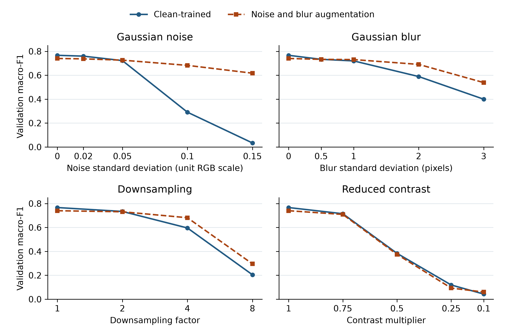

# Noise and Blur Augmentation in Galaxy10 DECaLS Morphology Classification

**Salman El Haddadi**

Independent researcher

## Abstract

I compared two convolutional neural networks trained on Galaxy10 DECaLS with identical geometric augmentation. One network also received Gaussian noise and blur during training. I evaluated both checkpoints from a single matched training seed on 1,762 validation images under four types of synthetic image degradation. Noise and blur augmentation reduced macro-F1 on unmodified images from 0.7665 to 0.7400. At a Gaussian noise standard deviation of 0.10 on the unit RGB scale, macro-F1 increased from 0.2909 to 0.6824. The augmented model also scored higher under stronger blur and at larger downsampling factors. Results under reduced contrast were mixed. The benefits of the augmentation policy varied with the type and severity of the perturbation.

## Introduction

Galaxy Zoo volunteer classifications support supervised learning of galaxy morphology from optical images (Walmsley et al. 2022). Pandya et al. (2023) tested robustness to Poisson perturbations and one-pixel attacks on Galaxy10 DECaLS, and Cao et al. (2024) evaluated a galaxy morphology classifier under Gaussian and salt-and-pepper noise. I used one architecture and a fixed set of training settings to examine how adding Gaussian noise and blur during training changes the balance between performance on unmodified images and performance under four synthetic perturbations.

## Data and Methods

Galaxy10 DECaLS contains 17,736 labeled RGB cutouts (Leung & Bovy 2024) rendered from the DESI Legacy Imaging Surveys' g, r, and z bands (Dey et al. 2019). I excluded 121 images belonging to 60 groups of pixel-identical images with conflicting labels. This set included three visually confirmed blank images. I placed pixel-identical images and pairs separated by at most 3 arcsec in the same group, including links through intermediate images. Stratified group splitting allocated 14,091 images to training, 1,762 to validation, and 1,762 to a reserved test partition. Each retained group was assigned to a single partition. I resized images from 256 × 256 to 128 × 128 pixels with area interpolation and standardized each RGB channel using training-set statistics.

Both models used the same 391,466-parameter network, with four convolutional blocks, global average pooling, dropout, and a ten-class linear output layer. I trained both models with random seed 0 for 30 epochs using unweighted cross-entropy, Adam with a learning rate of 0.001 and zero weight decay, and a batch size of 32. Both runs used independent horizontal and vertical flips, each with probability 0.5, and uniformly sampled right-angle rotations. The augmented run applied an additional transformation with probability 0.5 each time an image was presented during training. Gaussian noise and blur were equally likely. Their standard deviations were drawn uniformly from 0 to 0.10 on the unit RGB scale and from 0 to 2 pixels, respectively. I selected the checkpoint with the highest macro-F1 on unmodified validation images, breaking ties in favor of the earliest epoch. Both selected checkpoints came from epoch 30.

I evaluated both checkpoints on the same CPU with the same software and validation images. The 20 configurations included an unmodified view and an identity setting for each perturbation type. Perturbations were applied to RGB intensities on [0,1] before standardization. I applied additive Gaussian noise with clipping, Gaussian blur, area downsampling followed by bilinear upsampling, and contrast reduction toward the mean intensity across pixels and channels. Both models received the same noise realization for each image and severity. I averaged F1 across all ten classes, assigning zero to undefined class scores. I also examined accuracy, negative log-likelihood (NLL), and top-confidence expected calibration error (ECE) with 15 equal-width bins.

## Results

On unmodified validation images, macro-F1 fell from 0.7665 to 0.7400 with augmentation, a decrease of 0.0265. Accuracy fell from 0.7940 to 0.7656. At Gaussian noise standard deviations of 0.10 and 0.15, macro-F1 rose from 0.2909 to 0.6824 and from 0.0337 to 0.6170, respectively (Figure 1). At blur standard deviations of 2 and 3 pixels, macro-F1 rose from 0.5890 to 0.6906 and from 0.3996 to 0.5385, respectively. The highest noise and blur settings exceeded the ranges used during training.

Downsampling and contrast reduction were absent from the training policy. At fourfold and eightfold downsampling, macro-F1 rose from 0.5957 to 0.6813 and from 0.2046 to 0.2956, respectively. At a contrast multiplier of 0.25, macro-F1 fell from 0.1191 to 0.0933. At a multiplier of 0.10, both macro-F1 scores were below 0.061.

At a noise standard deviation of 0.10, ECE fell from 0.2219 to 0.0397 and NLL fell from 1.9007 to 0.8691 with augmentation. At a blur standard deviation of 2 pixels, ECE rose from 0.0206 to 0.0667 even though macro-F1 improved and NLL fell from 1.0048 to 0.8513.

**Figure 1.** Macro-F1 for the two seed-0 checkpoints on 1,762 validation images. The leftmost point in each panel is the identity transformation. The downsampling axis is logarithmic in base two, and contrast decreases from left to right.

## Discussion

Noise and blur augmentation yielded the largest gains under stronger noise, and improvements extended to some levels of downsampling even though the training policy excluded it. Because the policy combined noise and blur, this comparison cannot isolate which transformation contributed to the downsampling gains.

I used the same validation partition for checkpoint selection and perturbation evaluation. The results describe two checkpoints from one training seed and cannot establish variation across seeds or performance on the reserved test set. Because the perturbations act on rendered RGB cutouts, the severities cannot be translated into detector noise, telescope exposure, or survey depth.

## Data and Code Availability

The raw cutouts are available from Leung & Bovy (2024). The split indices, audit, evaluation code, and two run archives with the saved checkpoints and matching normalization files are available in the [project repository](https://github.com/Salman-Elhaddadi/Galaxy10-research/tree/156903fe6cba65de2d096e08bfb6744320d745f1). The machine-readable data accompanying Figure 1 contain the validation scores for each evaluated setting.

## Acknowledgments and Disclosure
I thank the Galaxy Zoo volunteers and the teams behind the Dark Energy Camera Legacy Survey, Beijing-Arizona Sky Survey, and Mayall z-band Legacy Survey for making the labels and imaging available. These surveys used the Blanco, Bok, and Mayall telescopes, respectively. NSF's NOIRLab and Lawrence Berkeley National Laboratory supported data processing and analysis. I acknowledge the significance of I'oligam Du'ag (Kitt Peak) to the Tohono O'odham Nation. Further credits are available in the [Legacy Surveys acknowledgment](https://www.legacysurvey.org/acknowledgment/).

OpenAI Codex assisted with drafting, copyediting, rerunning the existing evaluator, and plotting the archived scores. The plotted macro-F1 values were verified by recomputing them from the saved predictions.

## References

- Cao, J., Xu, T., Deng, Y., et al. 2024, A&A, 683, A42. [doi:10.1051/0004-6361/202348544](https://doi.org/10.1051/0004-6361/202348544)
- Dey, A., Schlegel, D. J., Lang, D., et al. 2019, AJ, 157, 168. [doi:10.3847/1538-3881/ab089d](https://doi.org/10.3847/1538-3881/ab089d)
- Leung, W. H., & Bovy, J. 2024, Galaxy10 DECaLS, v1, Zenodo. [doi:10.5281/zenodo.10845026](https://doi.org/10.5281/zenodo.10845026)
- Pandya, S., Patel, P., O, F., & Blazek, J. 2023. [arXiv:2311.01500](https://arxiv.org/abs/2311.01500)
- Walmsley, M., Lintott, C., Géron, T., et al. 2022, MNRAS, 509, 3966. [doi:10.1093/mnras/stab2093](https://doi.org/10.1093/mnras/stab2093)
